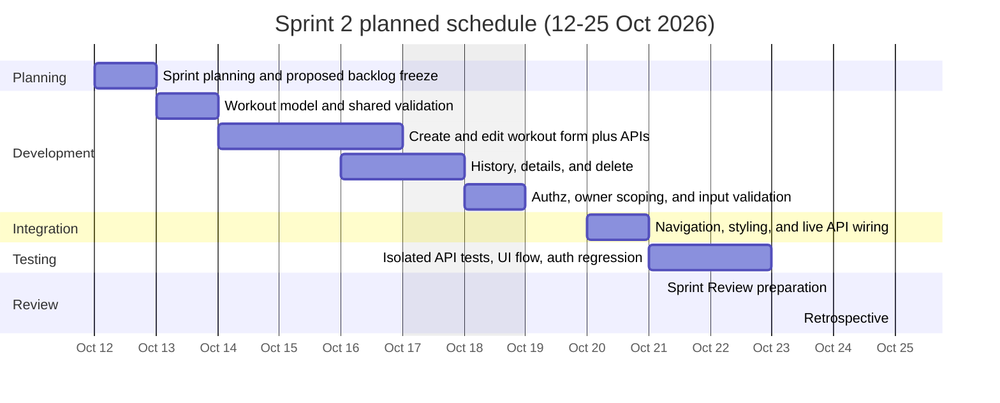

# Sprint 2 Gantt chart

**Calendar window:** 12 October 2026 – 25 October 2026.  
**Date source:** These are **planned / suggested dates** for a two-week sprint. They are not a record of actual historical work, and 25 October 2026 is **not** claimed as the D2L submission deadline.

Weekend shading is a planning convenience only. Course process events on 24–25 October remain **planned** until the team actually holds them.
