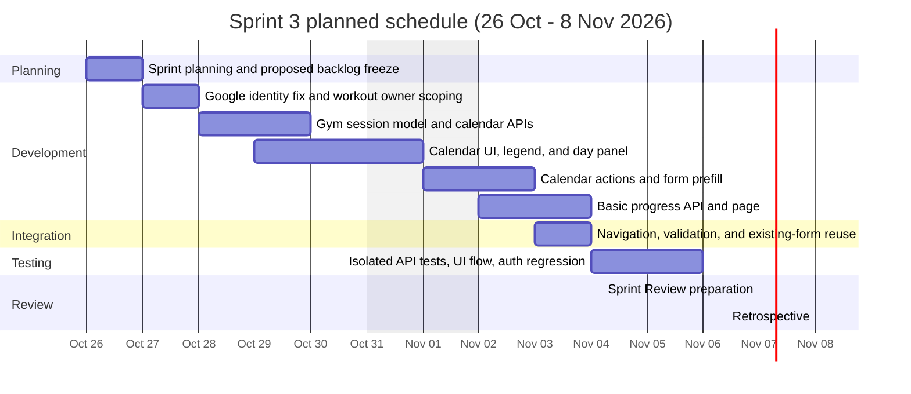

# Sprint 3 Gantt chart

**Calendar window:** 26 October 2026 – 8 November 2026 (course weeks beginning 26 October and 2 November 2026).  
**Date source:** These are **planned / suggested dates** for a two-week sprint. They are not a record of actual historical work, and 8 November 2026 is **not** claimed as a submission deadline.

Weekend shading is a planning convenience only. Course process events on 7–8 November remain **planned** until the team actually holds them.
